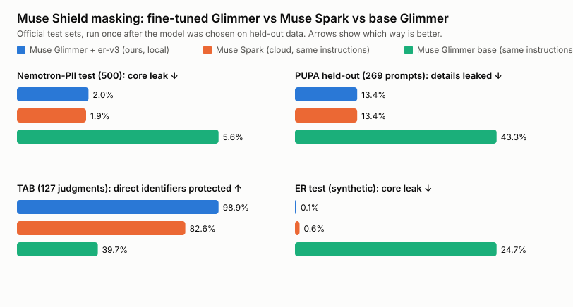
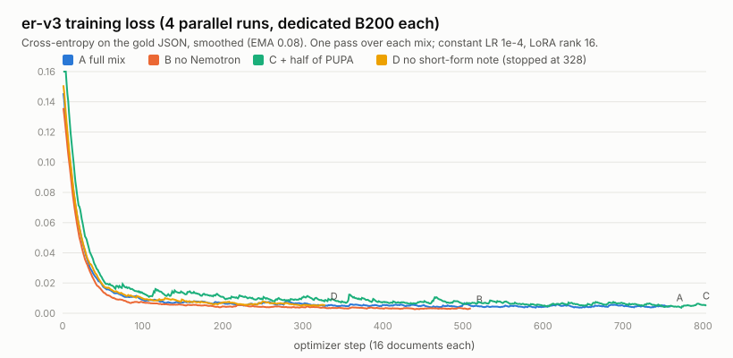
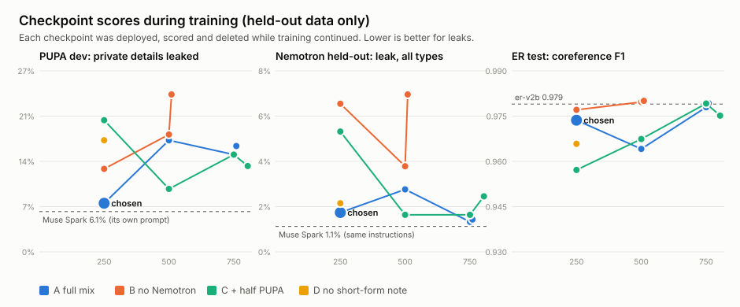
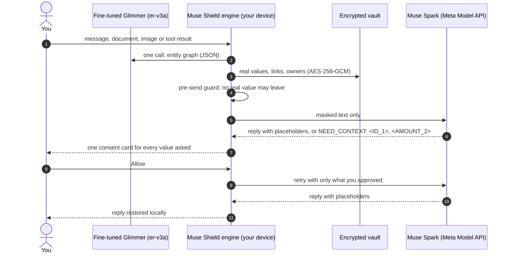

# Muse Shield

**Use Meta's Muse models on your real work without handing over your real data.**

Muse Shield is a local **privacy entity engine** that sits between you and Muse Spark. It is not find-and-replace
PII masking. Before anything leaves your device, **our fine-tuned Muse Glimmer 30B** reads the message, document or
tool result and builds an **entity graph**:

- **Entities.** Every person, organisation and private value: money, IDs, contacts, addresses, dates, secrets and
  health details.
- **Coreference.** "Rohan Majji", "Rohan", "Mr. Majji" and `rohan@mail` are one identity with one placeholder, across
  turns and across chats.
- **Ownership.** Whose salary, whose phone, whose account.
- **Relations.** `MANAGES`, `WORKS_FOR`, `PARENT_OF`, and so on.
- **Context.** In "PII + context" mode, a whole confidential passage (a deal, a diagnosis, a plan) becomes one
  placeholder, with its inner values masked too.

Muse Spark reasons over `<PERSON_1>`, `<AMOUNT_2>`, `<DEAL_1>`. The reply is restored on your device from an encrypted
vault. When Spark genuinely needs a hidden value, it has to **ask**, and you choose what to share.

> Built for the **Meta Global AI Developer Hackathon** (Cerebral Valley, Oct 26 – Nov 4 2026), track **Build for Your
> World**.
>
> **Our model:** [TheEmperor2/muse-shield-glimmer-er-v3a](https://huggingface.co/TheEmperor2/muse-shield-glimmer-er-v3a),
> a LoRA on Muse Glimmer 30B. **Its training data:**
> [TheEmperor2/muse-shield-er-v3-data](https://huggingface.co/datasets/TheEmperor2/muse-shield-er-v3-data).
> **Full release record:** [`results/er-v3-release/`](results/er-v3-release/README.md).

### Which models run where

| Step | Model | Sees |
|---|---|---|
| **Masking:** find, link and own every private value | **Our fine-tuned Muse Glimmer 30B** (`muse-shield-glimmer-er-v3a-s250`, a LoRA) | the raw text, on infrastructure you control |
| **Images:** faces, plates, ID and bank cards, documents, signatures, QR codes | **SAM 3.1** (Meta Model API) | the raw image; faces are blurred and the rest covered before any chat model sees it |
| **Answering:** and planning agent tool calls | **Muse Spark 1.3** (Meta Model API, Standard tier only) | masked text and masked images, nothing else |

Muse Spark is **never** used for masking. The pitch is that the part that sees your data is a model you own.

---

## Results: our fine-tuned 30B Glimmer matches Muse Spark at protecting data



| Benchmark | Metric | **Glimmer + er-v3a (ours, local)** | Muse Spark, same instructions | Muse Spark, own prompt | Glimmer base | er-v2b (our previous) |
|---|---|---|---|---|---|---|
| [Nemotron-PII](https://huggingface.co/datasets/nvidia/Nemotron-PII) test (500 docs) | core leak ↓ | **2.0%** | 1.9% | 14.0% | 5.6% | 25.4% |
|  | leak, all types ↓ | **9.5%** | 9.0% | 15.8% | 11.7% | 31.3% |
| PUPA held-out (269 real chatbot prompts) | details leaked ↓ | **13.4%** | 13.4% | 7.9% | 43.3% | — |
|  | prompts fully protected ↑ | **86.2%** | 81.8% | 86.2% | 62.1% | — |
| TAB (127 ECHR court judgments) | direct identifiers protected ↑ | **98.9%** | 82.6% | — | 39.7% | 49.8% |
|  | quasi identifiers protected ↑ | **77.2%** | 81.5% | — | 25.8% | 57.1% |
|  | precision ↑ | **85.1%** | 77.7% | — | 77.5% | 97.9% |
| Entity-resolution test (synthetic, 150) | core leak ↓ | **0.1%** | 0.6% | — | 24.7% | 0.1% |
|  | coreference F1 ↑ | **0.974** | 0.891 | — | 0.567 | 0.979 |
|  | owner accuracy ↑ | **99.5%** | 96.5% | — | 73.5% | 99.5% |
| Challenge (unseen document types, 80) | coreference F1 ↑ | **0.958** | 0.855 | — | 0.633 | 0.968 |
| Ambiguity (80) | UNKNOWN owners right ↑ | **96.2%** | 83.0% | — | 37.7% | 96.2% |

- **Leak rates.** Fine-tuning took base Glimmer from 5.6% to **2.0%** core leak on Nemotron, level with Muse Spark.
  On real prompts (PUPA) the share of prompts fully protected rose from 62.1% to **86.2%**.
- **Entity resolution.** It beats Muse Spark on direct identifiers in court judgments (98.9% vs 82.6%), on
  coreference (0.974 vs 0.891) and on ownership (99.5% vs 96.5%). That is the part that makes this an entity engine.
- **Baselines.** "Same instructions" gives Muse Spark and base Glimmer our v3 instructions plus a worked example. Our
  model runs without the example. The official test sets were each run once, after the checkpoint was chosen.

**In the product** (the Muse Shield app end to end, er-v3a vs er-v2b, made-up data):

| Test | er-v2b | **er-v3a** |
|---|---|---|
| Realistic multi-line messages, leak rate | 5.2% | **1.3%** |
| Multi-turn conversations, leak rate | 11.0% | **3.4%** |
| Word documents, values missed | 4 of 77 | **1 of 77** |
| PDF, values hidden | — | **77 of 77** |
| Agent scenarios (tool calls, outbox, executor) | — | **20 of 20** |

Every run, with its manifest, raw predictions and charts, is in [`results/`](results/README.md).

## Fine-tuning: how er-v3a was made

**The task.** Given a document split into numbered units, return one JSON entity graph: entities with every mention
(names, first names, titles, pronouns, descriptions), type, role, owner, and the relations between them. Code, not the
model, then places the placeholders. Model offsets are never trusted: every mention is found by exact search, and
anything that can't be found is dropped.

### Data: 12,160 training rows

| Source | Docs | What it teaches |
|---|---|---|
| er-v2 documents (our generator, relabelled under the stricter v3 policy) | 4,545 | people, coreference, owners, relations |
| New generated families: chat requests, IT tickets, profile forms, schedules | 3,615 | links, usernames, IPs, secrets, places, organisations, times, demographics |
| [Nemotron-PII](https://huggingface.co/datasets/nvidia/Nemotron-PII) **train** split (NVIDIA, CC BY 4.0), converted | 4,000 | breadth of real-world value types |

- **Every generated document is fictional.** Code plans the people and values, an LLM writes the text with inline tags,
  and code checks and repairs the tags. A second model pass must then agree on owners and references.
- **Decontamination.** Any training text sharing a 12-word run with a benchmark or test text was dropped: 910 er-v2
  and 169 Nemotron documents. Nemotron rows come only from the train split. PUPA was split by conversation, and the
  chosen model never saw a PUPA prompt.
- **Published:** the data is on [Hugging Face](https://huggingface.co/datasets/TheEmperor2/muse-shield-er-v3-data) and
  in [`results/er-v3-release/data/`](results/er-v3-release/data/), including the exact training file of the released
  model (`train-A.jsonl.gz`).

### Training



- **LoRA:** rank 16, alpha 32, on `q,k,v,o,gate,up,down_proj`.
- **Optimiser:** learning rate 1e-4 (constant), batch 16, one pass.
- **Loss:** on the answer only, with a maximum length of 6,144 tokens.
- **Compute:** Fireworks, one B200 per variant.
- **Runs:** four variants (A–D) trained in parallel. Eval loss went from 0.1715 to 0.0037 (run A).
- **Logs and configs:** [`results/er-v3-release/training/`](results/er-v3-release/training/).

### Choosing the checkpoint without looking at the test sets



Every 250 steps, each checkpoint was deployed on a temporary H200 and scored on **held-out data only**: our synthetic
regression gates, 150 unused Nemotron train documents, 80 unused generated chats, and a 101-prompt PUPA dev slice.
Later checkpoints scored higher on the synthetic sets but leaked about twice as much on real prompts, so we chose
**run A, step 250**. Full table: [`checkpoints.md`](results/er-v3-release/checkpoints/checkpoints.md).

### How we got here

| Model | What changed | Nemotron core leak |
|---|---|---|
| Muse Glimmer 30B, base | — | 10.6% (v2 prompt) |
| lora-v1 to v1d | PII span tagging on Nemotron train plus our synthetic set | 1.5% (v1d), but only 72% recall on our sector set, and no linking |
| lora-v2-full | PII plus confidential passages (now the "PII + context" mode) | 98.7% recall on our sector set |
| er-v2b | first entity-resolution model: coreference, owners, relations | 25.4% (missed new value types) |
| **er-v3a (step 250)** | stricter v3 policy, new families, Nemotron breadth, held-out checkpoint selection | **2.0%** |

## How it works



- **Masking.** The same value always gets the same placeholder in a chat, and is linked across chats by an HMAC value
  hash, never by the value itself. If analysis fails or returns invalid JSON, **nothing is sent**.
- **The pre-send guard.** Before every call to Muse Spark, the engine checks the outgoing messages for any real value
  in the vault that you haven't approved. If one is there, it refuses to send. This catches a value the model found in
  one place and missed in another.
- **Asking.** Spark asks for everything it needs in one go. You approve each item, choosing a passage's shape, a
  summary or the full text, or for an image just one region ("show the plate, keep the face blurred").
- **Agents.** Spark plans tool calls with placeholders. You confirm the real values on a card, and a local executor
  fills them in. Recipients must be your own contacts, never an address that came from an email. Secrets and IDs are
  never sent.

The full protocol is in [`CONTRACT.md`](CONTRACT.md).

## What's built

| Area | What you get | Where |
|---|---|---|
| **Engine** | FastAPI on `127.0.0.1`: mask, unmask, chat, reveal, vault, graph, inspector, metrics | [`muse_shield/app/`](muse_shield/app/) |
| **Two-call privacy flow** | Spark analyses, then answers over placeholders; the `NEED_CONTEXT` consent skill offers three levels of reveal, up to 2 rounds per turn | `chat.py`, `engine.py` |
| **Encrypted vault** | SQLite + AES-256-GCM (row identity as associated data), HMAC value hashes for cross-chat linking, `secure_delete`, consent log, per-chat entity graph | `vault.py` |
| **Context blocks** | Whole confidential passages (deals, plans, decisions, incidents) collapse to one placeholder; replies show the passage as its summary, with the full text on expand | `engine.py` |
| **Web app** | React 19 + Vite + Tailwind + shadcn/ui: live "being analysed" animation, pastel colour per data type, a "Muse Spark receives" preview, consent cards, markdown replies, vault panel | [`apps/web/`](apps/web/) |
| **Documents (PDF, Word, PowerPoint)** | Attach a file to a chat or download a masked copy in the same format. Tracked changes, comments, links, images, charts and metadata are stripped first; PDFs are truly redacted (text under each box removed, the placeholder written back as selectable text); a verifier reopens every copy and refuses it if any masked value is left anywhere in the file | [`muse_shield/documents/`](muse_shield/documents/) |
| **Chrome extension for meta.ai** | Replaces meta.ai's box with a Muse Shield composer the page can't read; Grammarly-style underlines; restored replies and consent cards inside the meta.ai chat | [`apps/extension/`](apps/extension/) |
| **Agents over placeholders** | Muse Spark plans tool calls (`TOOL_CALL`) with placeholders; a confirm card shows the real values before anything runs; a local executor fills them in only for a call you confirmed; encrypted outbox, signed envelopes, sealed grants and an HMAC-chained audit log | [`muse_shield/agent/`](muse_shield/agent/) |
| **Connections** | Anyone signs in from the app: Google (Gmail, Calendar, Contacts) with Google's own sign-in, Telegram with phone and code, and a folder of files picked with the Mac's own folder picker (PDF, Word, PowerPoint, text, CSV). Sign-ins are kept encrypted in the vault; reads are masked, sends need your OK. Setup for the app's keys: [docs/connections.md](docs/connections.md) | [`muse_shield/connectors/`](muse_shield/connectors/), `connections_api.py` |
| **Image masking** | SAM 3.1 finds faces, licence plates, ID and bank cards, documents, signatures and QR codes; faces are blurred and the rest covered with their vault placeholder (`<LICENSE_PLATE_1>`). Muse Spark can ask for one region ("just the plate") and you see a preview before you allow it | [`muse_shield/images/`](muse_shield/images/), `POST /images/mask` |
| **Inspector and leak audit** | Every outbound request recorded (analysis vs answer), audited for leaked values, with tokens, latency and cost | `inspector.py`, `/inspector/audit` |
| **Shared client** | TypeScript types and API client for the web app now, and Electron and React Native later | [`packages/core/`](packages/core/) |
| **Evals and benchmarks** | Public PII benchmark, realistic multi-line and multi-turn loops, agent scenarios; every run versioned with data, charts and cost | [`muse_shield/benchmarks/`](muse_shield/benchmarks/), [`results/`](results/README.md) |

**While it works, you see what it's doing.** A live status names the step that's running on your device ("Accessing
your Gmail", "Reading your Telegram", "Calculating on your device"). Calculations show as numbered steps, with what Muse
Spark planned using placeholders above the same sum with your real amounts. The app opens at once, so you can sign in
to Connections while the masking model starts. Long text (a bank statement, a long document) is masked in parallel
chunks: a 2,000-character statement takes about 16 s instead of about 60 s.

**Masking modes** (chosen per chat): **Entity resolution** (er-v3a), **Entity resolution + classify** (the same model
also names the document's category and its extra sensitive details), and **PII + context** (`lora-v2-full`: whole
confidential passages become one placeholder).

**Safety defaults.** The app refuses Muse Spark *Contributor* models, which let Meta train on prompts. Masking stays
off unless `MUSE_SHIELD_DEV_RAW_ANALYSIS=1` is set, because raw text goes to your own Glimmer deployment on Fireworks
(see [Limitations](#limitations)).

## Quick start

> **Use made-up data only** while prototyping: raw text goes to your own Fireworks deployment of the
> fine-tuned Glimmer, and raw images to SAM 3.1 on the Meta Model API.
>
> **You need:** Python 3.12, Node 20, a Meta Model API key (`MODEL_API_KEY`, for Muse Spark and SAM 3.1) and a
> Fireworks key (`FIREWORKS_API_KEY`, to deploy the fine-tuned Glimmer). The LoRA weights are on
> [Hugging Face](https://huggingface.co/TheEmperor2/muse-shield-glimmer-er-v3a), so you can also serve them yourself.

```bash
python3 -m venv .venv
.venv/bin/pip install -e '.[dev]'
cp .env.example .env               # add MODEL_API_KEY (Meta Model API) and FIREWORKS_API_KEY
```

```bash
MUSE_SHIELD_DEV_RAW_ANALYSIS=1 .venv/bin/python -m muse_shield.app    # http://127.0.0.1:8765
```

Each start creates a live-merge deployment of `muse-shield-glimmer-er-v3a-s250` on one H200 (a few
minutes, billed per hour while it's up), waits until it answers, and points masking at it. **Ctrl-C
deletes it.** A deployment a crashed run left behind is reused, not duplicated. To use a deployment you
already run, set `MUSE_SHIELD_GLIMMER_ER_MODEL=<model>#<deployment>`; `MUSE_SHIELD_GLIMMER_LORA` picks
another LoRA. New chats offer **Entity resolution** and **Entity resolution + classify** (the same
model, plus the document's category and its extra private details); each chat stays in the mode it
started with. For **PII + context**, point `MUSE_SHIELD_GLIMMER_PII_MODEL` at a deployment of
`muse-shield-glimmer-lora-v2-full`.

To use your own adapter, upload the Hugging Face weights to your Fireworks account as a LoRA and set
`MUSE_SHIELD_GLIMMER_LORA` to its id.

**Try it.** Paste a customer record and ask for a payment reminder. Connect Gmail in **Connections** and say *"Check
my inbox and tell me what needs my attention"*. Or attach a photo of a car and ask for an insurance email.
`scripts/seed_google_demo.py` fills a Google account with made-up mail, contacts and events (`--clean` removes
them).

Each message or document goes to the model in one call. Every mention of a person ("Rohan Majji",
"Rohan", "Mr. Majji") shares one placeholder, also on later turns. Pronouns and descriptions ("his",
"the employee") stay readable. Owners (whose salary, whose phone) and relations (MANAGES, PARENT_OF, …)
become vault links. The contract is in `muse_shield/resolution.py`.

The engine serves the built web app at `/`. To work on the UI with hot reload:

```bash
npm --prefix apps/web install
npm --prefix apps/web run dev      # http://localhost:5173 (ENGINE_URL=http://127.0.0.1:<port> if not 8765)
```

To use it on meta.ai, load [`apps/extension/`](apps/extension/README.md) unpacked in
`chrome://extensions` and open meta.ai.

Offline agent demo, with no API key needed:

```bash
.venv/bin/python -m muse_shield.agent.demo    # prints DEMO OK
```

## Testing and evals

```bash
.venv/bin/pytest                                            # 296 tests, offline
MUSE_SHIELD_DEV_RAW_ANALYSIS=1 .venv/bin/python -m muse_shield.images.eval --photo street.jpg=4
.venv/bin/python -m muse_shield.realistic --rounds 3 --tag my-run
.venv/bin/python -m muse_shield.agent.scenarios --rounds 2
.venv/bin/python -m muse_shield.document_eval --rounds 1     # the realistic set as PDF, Word and PowerPoint
.venv/bin/python -m muse_shield.benchmarks.run --help       # Nemotron-PII, any backend
```

The tests cover vault encryption and concurrency, masking, the consent flow and its guard,
the inspector and leak audit, the agent protocol, executor, grants and audit chain, benchmark
scoring, and cost accounting. Every eval writes to
`results/<eval>/<time>_v<version>+<commit>_<tag>/`: a manifest with code version, settings and
dataset hash, the full report, raw predictions and an HTML chart. The run is also added to
[`results/index.jsonl`](results/index.jsonl).

## Roadmap: what's left

### 1. Fine-tune the analysis model, then move it off Meta *(done)*
The analysis call is the only one that ever sees raw text, so it is the one to own. **er-v3a now does all masking**, at
Muse Spark's leak rate (see [Results](#results-our-fine-tuned-30b-glimmer-matches-muse-spark-at-protecting-data)).
- [x] Training-set builder in the exact runtime prompt format, with name, org, place and
      amount pools disjoint from the eval set ([`trainset.py`](muse_shield/trainset.py))
- [x] Base Muse Glimmer 30B benchmarked: 21.1% leak, the number to beat
- [x] LoRA SFT of Muse Glimmer 30B on Fireworks: 4 adapters trained on Nemotron-PII *train*
      plus our synthetic set, with a leakage guard against the test sample
      ([`feature/glimmer-lora`](https://github.com/MajjiR/muse-shield/tree/feature/glimmer-lora), `results/training/`)
- [x] Entity-resolution fine-tunes (er-v2b, er-v3 A–D) with held-out checkpoint selection; er-v3a step 250 is level
      with Muse Spark on Nemotron and PUPA, and ahead on TAB, coreference and ownership
- [x] Weights and training data on Hugging Face
- [ ] Self-host the tuned adapter (vLLM or SGLang, set `GLIMMER_BASE_URL`), so raw text never
      leaves infrastructure you control

### 2. Domain fine-tuning
One general model under-masks domain jargon and over-masks harmless words. Planned adapters:
- [ ] **Healthcare:** diagnoses, medications, MRNs, insurer IDs
- [ ] **Finance and banking:** account and card data, CVVs, loan and deal terms
- [ ] **Legal and HR:** case numbers, compensation, performance and disciplinary notes
- [ ] **Engineering:** API keys, tokens, hostnames, internal IPs, connection strings
- [ ] **India-specific IDs:** Aadhaar, PAN, GSTIN, IFSC, UPI handles

Each adapter is scored on its Nemotron-PII domains, plus a realistic set for that domain,
against both the base model and Muse Spark.

### 3. Broader benchmarks and testing
- [ ] Per-domain breakdowns of the existing Nemotron runs (all 29 domains)
- [ ] A second public set with a commercial-friendly licence (for example Gretel, Apache 2.0)
- [ ] **Utility, not just privacy:** answer quality with masking vs without, judged
      side by side, so we don't win on leak rate by masking everything
- [ ] An over-masking metric. Known cases: cities, brands, "admin", relative dates
- [ ] A date policy. Dates are the biggest miss on the benchmark, but many are harmless in chat
- [ ] Adversarial tests: prompt-injection attempts to make Spark echo or guess hidden values

### 4. Product
- [ ] Graph and inspector views in the web app (the API is already there)
- [x] Images: Muse Spark picks what's sensitive, SAM 3.1 finds faces, a re-scan checks the output
- [ ] Images in the web app and the meta.ai extension (the engine endpoint is there); SAM pixel masks instead of boxes
- [ ] Desktop app: Electron around the same web build, with the engine as a bundled Python
      sidecar, and the master key in the OS keychain
- [ ] Mobile: React Native on [`packages/core`](packages/core/)

## Limitations

- **Masking sees raw text, on a GPU you rent.** The fine-tuned Glimmer runs on your own Fireworks deployment, not on
  your laptop yet: a 30B model needs a GPU. Self-hosting the published weights (vLLM or SGLang) closes that gap. Until
  then, use made-up data.
- **The model can miss a later copy of a value.** The pre-send guard then blocks the message rather than leak it.
- **Very long documents** (10 or more pages in one call) occasionally get invalid JSON from er-v3a. The engine fails
  closed and sends nothing.
- **The model can over-mask.** Job titles, cities and relative dates are sometimes hidden.
  That's safe, but it can make answers vaguer.
- **Masking hides values, not inference.** A model can still guess from what's left in the
  structure. Context blocks and the shape/summary levels exist to limit this, but don't
  remove it.
- **The master key** is a local file (`~/.muse-shield/master.key`, mode 0600) or an
  environment variable, not a hardware-backed keystore yet.

## Repository

```
muse_shield/
  app/            engine: server, vault, masking, chat and consent, inspector, extension and document API
  documents/      PDF, .docx and .pptx: sanitize, extract, mask, write back, verify
  agent/          placeholder-only agents: protocol, tools, executor, grants, scenarios
  benchmarks/     Nemotron-PII sampling, label mapping, scoring, runner
  backends.py     Muse Spark, Muse Wonder and Muse Glimmer analysis backends (one JSON contract)
  realistic.py    realistic PII loop      conversations.py   multi-turn eval      document_eval.py   documents
  trainset.py     fine-tuning data        results.py, costs.py   versioned runs and spend
apps/web/         React web app (Electron later)
apps/extension/   Chrome extension for meta.ai
packages/core/    shared TypeScript types and client
results/          every recorded eval run
prototyping/      the first prototype: regex + local Llama 3.2 1B detector, OpenAI-compatible proxy
CONTRACT.md       the protocol every client codes against
```

## Meta models used

| Model | Via | Role |
|---|---|---|
| **Muse Glimmer 30B + our LoRA (er-v3a)** | Fireworks (training and on-demand deployment); weights on [Hugging Face](https://huggingface.co/TheEmperor2/muse-shield-glimmer-er-v3a) | **All text masking**: the entity graph for messages, documents and tool results |
| **Muse Glimmer 30B + lora-v2-full** | Fireworks | The "PII + context" masking mode |
| **Muse Spark 1.3** | Meta Model API (Standard) | Answers over masked text, agent planning, benchmark baseline. Never used for masking |
| **SAM 3.1** | Meta Model API | Faces, plates, cards, documents, signatures and codes for image masking |
| Muse Wonder 1.0 | Meta Model API | Smoke-tested on 5 docs; dropped (a coding and agentic model, at 3–5× Spark's price) |

## Licence

Muse Shield is licensed under the [GNU AGPL-3.0-or-later](LICENSE). PDF masking uses
[PyMuPDF](https://pymupdf.readthedocs.io/), which is AGPL-3.0, so anyone distributing a build
with document support (for example the planned desktop app) must publish its source under the
AGPL or buy a commercial PyMuPDF licence from Artifex. The other dependencies (cryptography,
FastAPI, lxml, python-docx, python-pptx, React and the web libraries) are permissively licensed.
