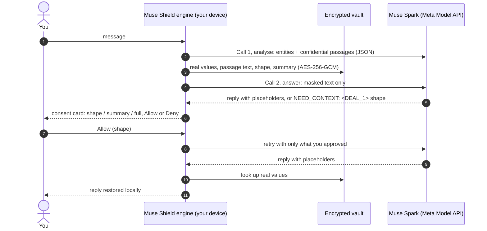

# Muse Shield

**Use Meta's Muse models on your real work without handing over your real data.**

Muse Shield is a privacy layer between people and Muse Spark. Before a message leaves your
device, it finds names, salaries, IDs, secrets, addresses and whole confidential passages,
and swaps them for consistent placeholders (`<PERSON_1>`, `<SALARY_1>`, `<DEAL_1>`). Muse Spark
reasons over the placeholders. The reply comes back and is filled in with your real values,
on your device, from an encrypted vault.

When the model genuinely needs something hidden, it has to **ask**, and you choose how much
to share: the passage's shape, a one-line summary, or the full text.

> Built for the **Meta Global AI Developer Hackathon** (Cerebral Valley, Oct 26 – Nov 4 2026),
> track **Build for Your World**. Every Meta model call goes through the **Meta Model API**
> (Muse Spark 1.3). Muse Glimmer 30B is benchmarked as the analysis model to fine-tune.

---

## Why

People already paste offer letters, medical notes, term sheets, card disputes and incident
reports into chat assistants. Today the choice is "share everything" or "don't use AI". Muse
Shield adds a third option: the model gets enough structure to be useful, and nothing that
identifies you unless you approve it.

```text
You type:   Hi, I'm Rohan Mehta. My salary is ₹32 lakh at Acme. Tomorrow I'm planning to
            buy land at 14 Lake View Road, Pune for ₹1.2 crore.
Spark sees: Hi, I'm <PERSON_1>. My salary is <SALARY_1> at <ORG_1>. <PLAN_1>
You read:   …a reply with Rohan, ₹32 lakh and the plan restored in place, highlighted by type.
```

## How it works



- **Call 1, analysis.** Muse Spark returns entities (text, type, and the role of each amount)
  and context blocks (which sentences, what kind, a names-free summary). The engine never
  trusts model offsets: it finds each entity by exact search and drops anything it can't find.
  If analysis fails, **nothing is sent**.
- **Masking.** Placeholders are numbered per chat. The same value always gets the same
  placeholder within a chat, and is linked across chats by an HMAC value hash, never by the
  value itself.
- **Call 2, answer.** Spark only sees masked text. A guard refuses to send any real value the
  user hasn't approved.
- **Rehydration** happens on your device. Placeholders the vault doesn't know are flagged as
  made up.

The full protocol is in [`CONTRACT.md`](CONTRACT.md).

## What's built

| Area | What you get | Where |
|---|---|---|
| **Engine** | FastAPI on `127.0.0.1`: mask, unmask, chat, reveal, vault, graph, inspector, metrics | [`muse_shield/app/`](muse_shield/app/) |
| **Two-call privacy flow** | Spark analyses, then answers over placeholders; the `NEED_CONTEXT` consent skill offers three levels of reveal, up to 2 rounds per turn | `chat.py`, `engine.py` |
| **Encrypted vault** | SQLite + AES-256-GCM (row identity as associated data), HMAC value hashes for cross-chat linking, `secure_delete`, consent log, per-chat entity graph | `vault.py` |
| **Context blocks** | Whole confidential passages (deals, plans, decisions, incidents) collapse to one placeholder; replies show the passage as its summary, with the full text on expand | `engine.py` |
| **Web app** | React 19 + Vite + Tailwind + shadcn/ui: live "being analysed" animation, pastel colour per data type, a "Muse Spark receives" preview, consent cards, markdown replies, vault panel | [`apps/web/`](apps/web/) |
| **Chrome extension for meta.ai** | Replaces meta.ai's box with a Muse Shield composer the page can't read; Grammarly-style underlines; restored replies and consent cards inside the meta.ai chat | [`apps/extension/`](apps/extension/) |
| **Agents over placeholders** | Muse Spark plans tool calls (`TOOL_CALL`) with placeholders; a confirm card shows the real values before anything runs; a local executor fills them in only for a call you confirmed; encrypted outbox, signed envelopes, sealed grants and an HMAC-chained audit log | [`muse_shield/agent/`](muse_shield/agent/) |
| **Image masking** | Muse Spark (vision) reads the image and finds sensitive values, faces, codes and ID photos; SAM 3.1 finds faces precisely; faces are blurred and values covered with their vault placeholder; Spark re-scans the output | [`muse_shield/images/`](muse_shield/images/), `POST /images/mask` |
| **Inspector and leak audit** | Every outbound request recorded (analysis vs answer), audited for leaked values, with tokens, latency and cost | `inspector.py`, `/inspector/audit` |
| **Shared client** | TypeScript types and API client for the web app now, and Electron and React Native later | [`packages/core/`](packages/core/) |
| **Evals and benchmarks** | Public PII benchmark, realistic multi-line and multi-turn loops, agent scenarios; every run versioned with data, charts and cost | [`muse_shield/benchmarks/`](muse_shield/benchmarks/), [`results/`](results/README.md) |

**Safety defaults.** The app refuses Muse Spark *Contributor* models, which let Meta train on
prompts. Analysis stays off unless `MUSE_SHIELD_DEV_RAW_ANALYSIS=1` is set, because call 1
still sends raw text to Meta (see [Limitations](#limitations)).

## Results so far

All runs, with manifests, raw predictions and charts, are in [`results/`](results/README.md).
Recorded eval spend so far: **$6.05**.

**Public benchmark: [nvidia/Nemotron-PII](https://huggingface.co/datasets/nvidia/Nemotron-PII)**
(CC BY 4.0). A stratified 500-document sample, 29 domains, 4,265 gold spans.

| Model (analysis call) | Leak rate ↓ | Core PII leak ↓ | Span recall ↑ | Precision ↑ | Valid JSON | Cost |
|---|---|---|---|---|---|---|
| Muse Spark 1.3, reasoning low | **15.8%** | **14.0%** | **83.0%** | 86.5% | **100%** | $0.61 |
| Muse Spark 1.3, reasoning medium | 16.6% | 14.8% | 82.0% | 86.3% | 100% | $0.96 |
| Muse Spark 1.3, reasoning high | 16.7% | 14.6% | 82.1% | 85.9% | 100% | $1.06 |
| Muse Glimmer 30B, **base, not fine-tuned** | 21.1% | 17.5% | 77.6% | **89.1%** | 97.3% | $0.79 (GPU) |

- *Leak rate* is the share of gold PII characters left unmasked. *Core* excludes
  quasi-identifiers such as occupation, language and education.
- More reasoning didn't help: medium and high were within noise of low on a paired bootstrap
  (+0.8 points, 95% interval crossing zero). The app runs Spark at low or minimal effort.
- Benchmark runs used Spark *Contributor* pricing, which is fine for public data. The app
  itself only uses Standard.
- **Where both models miss:** dates and times (Spark's DATE recall is 37%), languages,
  coordinates, occupations. Names, organisations, addresses, contacts and IDs are all at
  96–100% for Spark.

**Our own realistic sets** (made-up data, written to look like real messages):

| Eval | What | Result | Cost |
|---|---|---|---|
| Realistic PII loop | 10 multi-line messages (HR transfer, medical intake, card dispute, term sheet, travel, incident secrets, tax, school letter, rent, GST invoice) × 3 rounds | **0 of 231 must-mask values leaked**, 100% valid JSON | $0.13 |
| Realistic conversations | 6 multi-turn chats across sectors, 18 turns | **0.0% leak**, 100% recall | $0.06 |
| Agent scenarios | 16 tool-use scenarios (emails, invites, notes) through the executor | **16 of 16**, leak audit clean (15 of 16 before the fix for a false leak flag) | $0.19 |

**Images** (5 synthetic images with pixel-exact gold, 36 values, plus 2 public sample photos), Muse Spark 1.3 + SAM 3.1:

| Run | Values masked | Leaked after re-scan | Faces blurred | Harmless text hidden | Cost |
|---|---|---|---|---|---|
| refine v2 | **36/36** | 0 | 5/5 | 4.2% | $0.15 + 14 SAM calls |
| refine v2, repeat | 35/36 | 1 bar under 80% coverage (re-scan couldn't read it) | 5/5 | 10.4% | $0.15 + 14 SAM calls |
| first version, no refine pass | 20/36 | 17 | 5/5 | 6.2% | $0.08 |

Spark's grounding on a full image can be a line off; asking it again on a crop around each value fixed most of that. About 25 s per image, p50.

A masked message costs about **$0.004** and takes **about 4.6 s** at p50, analysis included.

## Quick start

> **Use made-up data only.** Until analysis runs on a self-hosted model, call 1 sends raw
> text to the Meta Model API.

```bash
python3 -m venv .venv
.venv/bin/pip install -e '.[dev]'
cp .env.example .env               # add MODEL_API_KEY (Meta Model API)
```

```bash
MUSE_SHIELD_DEV_RAW_ANALYSIS=1 .venv/bin/python -m muse_shield.app    # http://127.0.0.1:8765
```

The engine serves the built web app at `/`. To work on the UI with hot reload:

```bash
npm --prefix apps/web install
npm --prefix apps/web run dev      # http://localhost:5173 (ENGINE_URL=http://127.0.0.1:<port> if not 8765)
```

To use it on meta.ai, load [`apps/extension/`](apps/extension/README.md) unpacked in
`chrome://extensions` and open meta.ai.

Offline agent demo, with no API key needed:

```bash
.venv/bin/python -m muse_shield.agent.demo    # prints DEMO OK
```

## Testing and evals

```bash
.venv/bin/pytest                                            # 136 tests, offline
MUSE_SHIELD_DEV_RAW_ANALYSIS=1 .venv/bin/python -m muse_shield.images.eval --photo street.jpg=4
.venv/bin/python -m muse_shield.realistic --rounds 3 --tag my-run
.venv/bin/python -m muse_shield.agent.scenarios --rounds 2
.venv/bin/python -m muse_shield.benchmarks.run --help       # Nemotron-PII, any backend
```

The tests cover vault encryption and concurrency, masking, the consent flow and its guard,
the inspector and leak audit, the agent protocol, executor, grants and audit chain, benchmark
scoring, and cost accounting. Every eval writes to
`results/<eval>/<time>_v<version>+<commit>_<tag>/`: a manifest with code version, settings and
dataset hash, the full report, raw predictions and an HTML chart. The run is also added to
[`results/index.jsonl`](results/index.jsonl).

## Roadmap: what's left

### 1. Fine-tune the analysis model, then move it off Meta *(next)*
The analysis call is the only one that ever sees raw text, so it is the one to own.
- [x] Training-set builder in the exact runtime prompt format, with name, org, place and
      amount pools disjoint from the eval set ([`trainset.py`](muse_shield/trainset.py))
- [x] Base Muse Glimmer 30B benchmarked: 21.1% leak, the number to beat
- [ ] SFT Muse Glimmer 30B on Fireworks; re-run the same 500 Nemotron docs and the realistic
      loops. Target: below Spark's 15.8% leak, at Glimmer's precision
- [ ] Self-host the tuned adapter (vLLM or SGLang, set `GLIMMER_BASE_URL`), so raw text never
      leaves infrastructure you control

### 2. Domain fine-tuning
One general model under-masks domain jargon and over-masks harmless words. Planned adapters:
- [ ] **Healthcare:** diagnoses, medications, MRNs, insurer IDs
- [ ] **Finance and banking:** account and card data, CVVs, loan and deal terms
- [ ] **Legal and HR:** case numbers, compensation, performance and disciplinary notes
- [ ] **Engineering:** API keys, tokens, hostnames, internal IPs, connection strings
- [ ] **India-specific IDs:** Aadhaar, PAN, GSTIN, IFSC, UPI handles

Each adapter is scored on its Nemotron-PII domains, plus a realistic set for that domain,
against both the base model and Muse Spark.

### 3. Broader benchmarks and testing
- [ ] Per-domain breakdowns of the existing Nemotron runs (all 29 domains)
- [ ] A second public set with a commercial-friendly licence (for example Gretel, Apache 2.0)
- [ ] **Utility, not just privacy:** answer quality with masking vs without, judged
      side by side, so we don't win on leak rate by masking everything
- [ ] An over-masking metric. Known cases: cities, brands, "admin", relative dates
- [ ] A date policy. Dates are the biggest miss on the benchmark, but many are harmless in chat
- [ ] Adversarial tests: prompt-injection attempts to make Spark echo or guess hidden values

### 4. Product
- [ ] Graph and inspector views in the web app (the API is already there)
- [x] Images: Muse Spark picks what's sensitive, SAM 3.1 finds faces, a re-scan checks the output
- [ ] Images in the web app and the meta.ai extension (the engine endpoint is there); SAM pixel masks instead of boxes
- [ ] Desktop app: Electron around the same web build, with the engine as a bundled Python
      sidecar, and the master key in the OS keychain
- [ ] Mobile: React Native on [`packages/core`](packages/core/)

## Limitations

- **Analysis sees raw text today.** Call 1 sends the original message to Muse Spark Standard
  on the Meta Model API, which is why the app runs only with made-up data. Roadmap item 1
  fixes this.
- **The model can over-mask.** Job titles, cities and relative dates are sometimes hidden.
  That's safe, but it can make answers vaguer.
- **Masking hides values, not inference.** A model can still guess from what's left in the
  structure. Context blocks and the shape/summary levels exist to limit this, but don't
  remove it.
- **The master key** is a local file (`~/.muse-shield/master.key`, mode 0600) or an
  environment variable, not a hardware-backed keystore yet.

## Repository

```
muse_shield/
  app/            engine: server, vault, masking, chat and consent, inspector, extension API
  agent/          placeholder-only agents: protocol, tools, executor, grants, scenarios
  benchmarks/     Nemotron-PII sampling, label mapping, scoring, runner
  backends.py     Muse Spark, Muse Wonder and Muse Glimmer analysis backends (one JSON contract)
  realistic.py    realistic PII loop      conversations.py   multi-turn eval
  trainset.py     fine-tuning data        results.py, costs.py   versioned runs and spend
apps/web/         React web app (Electron later)
apps/extension/   Chrome extension for meta.ai
packages/core/    shared TypeScript types and client
results/          every recorded eval run
prototyping/      the first prototype: regex + local Llama 3.2 1B detector, OpenAI-compatible proxy
CONTRACT.md       the protocol every client codes against
```

## Meta models used

| Model | Via | Role |
|---|---|---|
| **Muse Spark 1.3** | Meta Model API | Call 1 analysis (for now) and call 2 answers; agent planning; reading images |
| **Muse Glimmer 30B** | Fireworks on-demand deployment | Benchmarked baseline; the model we fine-tune for on-device or self-hosted analysis |
| **SAM 3.1** | Meta Model API | Precise face and licence-plate boxes for image masking |
| Muse Wonder 1.0 | Meta Model API | Smoke-tested on 5 docs; dropped (a coding and agentic model, at 3–5× Spark's price) |
