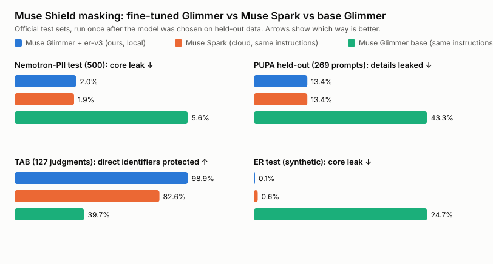
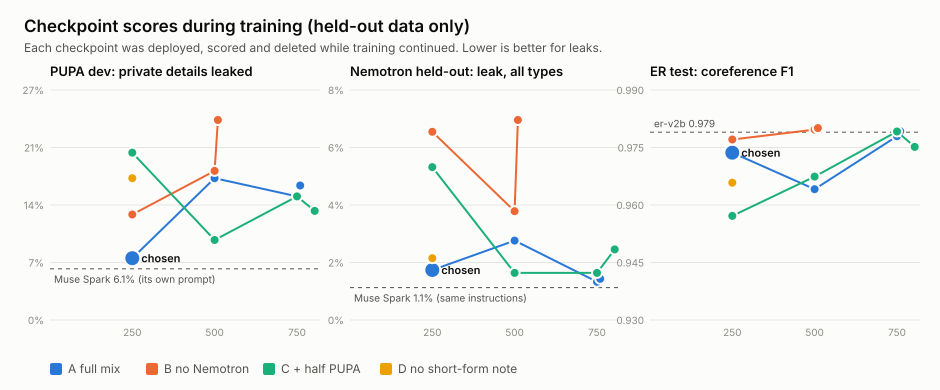
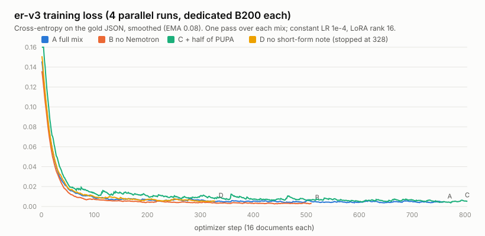

# Muse Shield er-v3: fine-tuned Muse Glimmer 30B for local privacy masking

The masking model that runs on the user's machine: **Muse Glimmer 30B + a LoRA we trained (er-v3, chosen checkpoint
`muse-shield-glimmer-er-v3a-s250`)**. It reads a document or chat message, finds every person, organisation and private
value, links mentions of the same person, says whose each value is, and code masks them before anything reaches the cloud
model (Muse Spark). This folder has everything needed to check the numbers: the data, the training logs, every checkpoint
score, and the official benchmark runs.

## Results (official test sets, run once)



| Benchmark | Metric | **Muse Glimmer + er-v3 (ours, local)** | Muse Spark, same instructions | Muse Spark, its own prompt | Muse Glimmer base | er-v2b (previous) |
|---|---|---|---|---|---|---|
| Nemotron-PII test (500 docs) | core leak ↓ | **2.0%** | 1.9% | 14.0% | 5.6% | 25.4% |
|  | leak, all types ↓ | **9.5%** | 9.0% | 15.8% | 11.7% | 31.3% |
| PUPA held-out (269 real prompts) | details leaked ↓ | **13.4%** | 13.4% | 7.9% | 43.3% | — |
|  | prompts fully protected ↑ | **86.2%** | 81.8% | 86.2% | 62.1% | — |
| TAB (127 ECHR judgments) | direct identifiers protected (ER_di) ↑ | **98.9%** | 82.6% | — | 39.7% | 49.8% |
|  | quasi identifiers protected (ER_qi) ↑ | **77.2%** | 81.5% | — | 25.8% | 57.1% |
|  | precision ↑ | **85.1%** | 77.7% | — | 77.5% | 97.9% |
| ER test (synthetic, 150) | core leak ↓ | **0.1%** | 0.6% | — | 24.7% | 0.1% |
|  | coreference F1 ↑ | **0.974** | 0.891 | — | 0.567 | 0.979 |
|  | owner accuracy ↑ | **99.5%** | 96.5% | — | 73.5% | 99.5% |
| Challenge (unseen doc types, 80) | coreference F1 ↑ | **0.958** | 0.855 | — | 0.633 | 0.968 |
| Ambiguity (80) | UNKNOWN owners right ↑ | **96.2%** | 83.0% | — | 37.7% | 96.2% |

- **Same instructions:** Muse Spark and base Glimmer get er-v3's v3 masking instructions plus a worked example (our
  fine-tune runs without the example). **Its own prompt:** Muse Spark with the app's original analysis prompt (PII +
  context, the cloud stand-in the app used before), for transparency: it is stronger on PUPA, weaker on Nemotron.
- **Synthetic rows** are our held-out generated test sets (never trained on). Spark and base were scored with the v2
  prompt those answer keys follow.
- **er-v2b** is the previous fine-tune (before er-v3) on the same official sets where it was run.
- Raw per-document predictions are in the run folders named in `benchmarks/comparison.json`.

## How the model was chosen (no peeking at the test sets)

Four variants trained in parallel, one dedicated B200 each. Every 250 steps each checkpoint was deployed on a temporary
H200 and scored on **held-out** data only: our synthetic test sets (regression gates against er-v2b), 150 unused
Nemotron *train* documents, 80 unused generated chat documents, and a 101-prompt PUPA dev slice. The official
Nemotron test (500) and PUPA final (269) sets were not touched until the choice was made.



Later checkpoints scored higher on the synthetic sets but leaked about twice as much on the PUPA dev slice (every run
showed this), so the step-250 checkpoint of run A was chosen. D was stopped at step 328: it lost to A on every metric.
Full table: `checkpoints/checkpoints.md`.

## Training



| Run | Training rows | Steps | Eval loss | Time | Model |
|---|---|---|---|---|---|
| A | 12,160 | 760 | 0.1715 → 0.0037 | 01:57–03:20 IST | muse-shield-glimmer-er-v3a |
| B | 8,160 | 510 | 0.1715 → 0.0033 | 01:57–02:59 IST | muse-shield-glimmer-er-v3b |
| C | 12,858 | 804 | 0.1715 → 0.0038 | 01:57–03:22 IST | muse-shield-glimmer-er-v3c |
| D | 12,160 | 328 | 0.1715 → nan | 01:57–02:35 IST | stopped at the step-250 checkpoint |

LoRA rank 16 / alpha 32 on attention and MLP, learning rate 1e-4 constant, batch 16, one pass, loss on the answer only,
max length 6,144 tokens. Per-step logs: `training/steps-*.csv`, full logs `training/run-*.log.gz`, configs `training/config-*.json`.

## Data

| Source | Documents | What it teaches |
|---|---|---|
| er-v2 documents (our generator, relabelled under the v3 policy) | 4,545 | people, coreference, owners, relations |
| New generated families: chat requests, IT tickets, profile forms, schedules | 3,615 | links, usernames, IPs, secrets, places, organisations, times, demographics |
| Nemotron-PII **train** split (NVIDIA, CC BY 4.0), converted | 4,000 | breadth of real-world value types |
| PUPA train half (run C only) | 349 | — (not in the chosen model) |

Every generated document is fictional: code plans the people and values, DeepSeek V4 Flash writes the text with inline
tags, code checks and repairs the tags, and a second model pass must agree on owners and references.
Files: `data/train-A.jsonl.gz` (the exact training file of the chosen model), `data/val.jsonl.gz`,
`data/generated-v3-families.docs.jsonl`, the held-out sets, and `data/manifest.json`.

### Keeping training and test apart

- Any training text sharing a 12-word run with a benchmark or test text was dropped: Nemotron test 500, all of PUPA,
  TAB test, our ER test / challenge / ambiguity sets (910 er-v2 and
  169 Nemotron docs removed).
- Nemotron rows are from the train split only; the 500 benchmark docs come from the test split, and any train doc
  matching one by id or text is dropped too.
- PUPA has no train split; it was split by conversation (`data/pupa-split.json`). The chosen model (run A) never saw any
  PUPA prompt; 269 prompts were never used for any decision and are the only PUPA numbers reported.
- The model was chosen on held-out data before the official runs, and the official runs were done once.

## Reproduce

```
.venv/bin/python -m muse_shield.resolution_data build --out runs/er/gen3 --n 4800 --seed 41 --only v3   # generated docs
.venv/bin/python -m muse_shield.er_v3_data build --out runs/er/v3                                     # mixes + checks
.venv/bin/python scripts/er_v3_launch.py --variants A B C D --checkpoint-every 250                    # training
.venv/bin/python scripts/er_ckpt_watch.py                                                            # checkpoint scores
.venv/bin/python scripts/official_v3.py --model muse-shield-glimmer-er-v3a-s250                      # official round
.venv/bin/python scripts/er_v3_report.py                                                             # this folder
```
